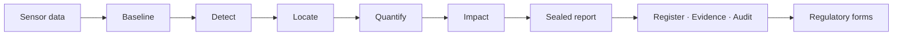

# Doude

> **Doude** — Izon for "found". *Every spill found, measured and recorded.*

Oil spills in the Niger Delta are self-reported by the operators, and dispute
over the released volume drives most compensation claims. Regulators at NOSDRA
and NUPRC have no independent way to check those numbers. Doude gives them a
repeatable, tamper-evident method — measured from pressure and flow alone.

---

## How it works



## The five functions

**Detect** — learns a baseline from the first 48 h of normal operation, then
flags a leak when the inflow/outflow imbalance exceeds the baseline mean by
5× the noise for 5 consecutive minutes (in 6 minutes for the harder scenario).

**Locate** — averages pressure and flow over the steady leak period and rewinds
the pressure drop along the pipe from both ends (gradient intersection), giving
a distance from the inlet plus an uncertainty band and a map position.

**Quantify** — integrates the minute-by-minute mass balance over the leak window,
cross-checks it against a steady-state average, back-calculates the equivalent
hole size, and produces an uncertainty range.

**Impact & sealed report** — models the water-surface slick (Fay spreading plus
current/wind drift) and seals everything as a signed report whose SHA-256 hash
only depends on the inputs and results, so it is repeatable.

**Data management** — persists each analysis as a spill record with a strict
status workflow (detected → jiv → cleanup → closed), evidence uploads, and an
append-only audit log chained with SHA-256 so any tampering is detectable.

## Results

| Scenario | Metric | Truth | Doude | Result |
|---|---|---|---|---|
| 01 — trunk line leak (25 mm @ 13.4 km) | Detection | ≤ 15 min | 5 min | ✅ |
| | Location | 13,400 m | 13,390 m | ✅ |
| | Volume | 4,580 m³ | 4,592 m³ | ✅ |
| 02 — small leak (10 mm @ 6.8 km) | Detection | ≤ 30 min | 6 min | ✅ |
| | Location | 6,800 m | 6,762 m | ✅ |
| | Volume | 782 m³ | 786 m³ | ✅ |

## Quick start

```bash
make setup        # venv + pip install + npm install
make demo         # data + engine (:8000) + app (:3000)
```

Then open http://localhost:3000.

### Resetting the local database (dev only)

The audit log is append-only and is never edited or repaired in place. To
start from a clean local state, stop the engine and run:

```bash
python -m engine.db --reset-dev
```

It lists what it will delete (`data/doude.db` with its WAL files, and
`data/evidence/`, generated reports in `data/reports/`) and asks you to type `reset` before deleting anything.
Restart the engine afterwards to recreate an empty database.

## API

| Method | Path | Purpose |
|---|---|---|
| GET | `/health` | status + method version |
| GET | `/scenario` | active scenario (no answers) |
| GET | `/readings?step=N` | sensor readings |
| POST | `/analyze` | full chain + persist (returns `spill_id`) |
| GET | `/verify` | report repeatability |
| GET | `/pipelines` | list pipelines |
| GET | `/spills` | list spills |
| GET | `/spills/{id}` | spill detail |
| POST | `/spills/{id}/status` | advance status |
| POST | `/spills/{id}/evidence` | upload evidence |
| GET | `/spills/{id}/evidence/{eid}` | download evidence |
| GET | `/spills/{id}/audit` | audit log |
| GET | `/audit/verify` | audit-chain verification |
| GET | `/report.pdf?spill_id=` | sealed spill report PDF |
| GET | `/forms/a.pdf?spill_id=` | EGASPIN Form A draft |
| GET | `/forms/a` | Form A data (JSON) |

## Project structure

```
doude/
├── engine/            # Python: detect, locate, quantify, report, pdf, db, api
│   ├── detect.py locate.py quantify.py impact.py report.py
│   ├── pdf_report.py forms.py db.py main.py
│   ├── build_scenario.py generate.py
│   └── test_*.py
├── scenarios/         # scenario_01.json, scenario_02.json
├── scenario.json      # active scenario (symlink target of the above)
├── data/              # readings.csv, doude.db, evidence/ (generated, gitignored)
├── app/               # Next.js + Tailwind dashboard
├── contracts/ docs/ scripts/
├── Makefile
└── .python-version    # 3.9
```

## Method (doude-method v0.1)

- **Friction** — Darcy-Weisbach with the Swamee-Jain friction factor.
- **Location** — gradient intersection: `x = (P_in − P_out − G_out·L) / (G_in − G_out)`.
- **Volume** — minute-by-minute mass balance `(Q_in − Q_out − baseline)·Δt`.
- **Hole size** — inverted orifice equation `Q = Cd·A·√(2P/ρ)`.
- **Spreading** — Fay gravity-viscous slick radius, drifted by current + wind.
- **Integrity** — SHA-256 over the sorted canonical JSON; audit log entries are
  chained (`entry_hash = SHA256(prev_hash + entry)`).

## Limitations & roadmap

- Synthetic seed-42 data only — no real SCADA feed yet.
- Steady-state physics (flat pipe, no transient hydraulics).
- Slick is a 6 h snapshot; land/soil penetration is not modelled.
- Form A is a draft to check against the official NOSDRA/NUPRC template.
- Next: real SCADA ingestion, Sentinel-1 satellite cross-check, community
  reporting, Forms B/C, and multi-tenant auth.

## Screenshots

| Dashboard | Spill detail | Evidence | Report |
|---|---|---|---|
|  |  |  |  |

---

Python 3.9 (pinned via `.python-version`). 3.10+ also works once `reportlab`
can be unpinned (currently `<5` because reportlab 5 requires 3.10+).